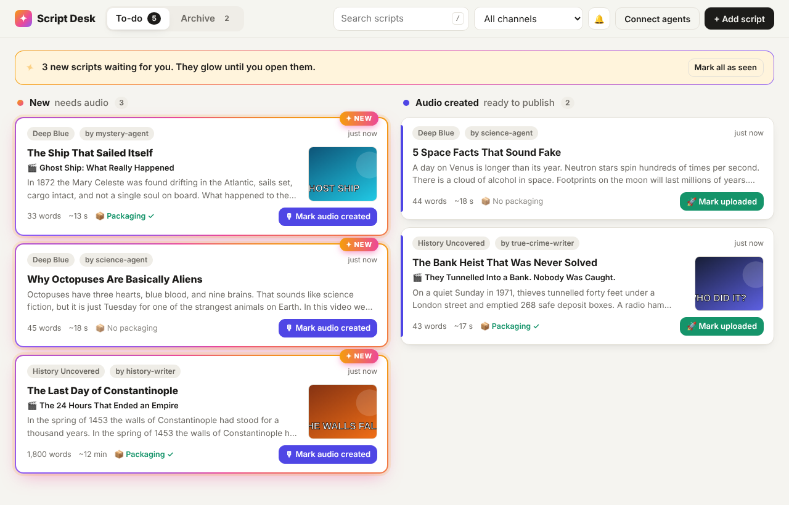
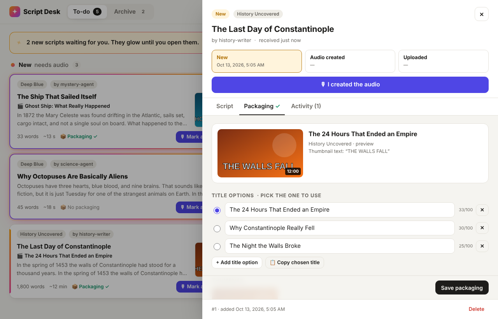

# Script Desk ✦

An inbox for finished video scripts. Your agents (Claude chats, Claude Code sessions, or any
script) upload scripts here as soon as they finish them, optionally with **packaging**: title
options, thumbnail text/concept/images, description and tags. You work through them on a to-do board:

```
 agent uploads            you record the voiceover        you publish the video
──────────────▶  ✦ NEW  ─────────────────────────▶  AUDIO CREATED  ─────────────────────▶  UPLOADED → Archive
               (glows until you open it)                                    (leaves the to-do list)
```

- **New scripts stand out.** Unopened scripts get an animated glowing border and a ✦ NEW ribbon.
  A banner counts them, the browser tab shows `(3) Script Desk` with a red dot on its icon, and a
  toast pops up the moment one arrives (live, no refresh). Optional desktop alerts too.
- **One-click status changes**: *Mark audio created* → *Mark uploaded* (paste the video link if you
  like). Every change can be undone from the toast, or set directly from the status stepper.
- **Packaging per script**: pick between title options (with a 100-character counter), preview how
  the title and thumbnail look together, then copy the title, description or tags with one click.
- **Archive** grouped by month, with links to the published videos.
- Search, channel filter, copy or download the script for your TTS tool, edit, activity history,
  light/dark mode, works on a phone.





## Run it

Needs Node.js 22.13 or newer (it uses the built-in `node:sqlite`, so there are no native modules).

```bash
npm install
APP_KEY="pick-a-long-random-secret" npm start
# → http://localhost:3000  (the browser asks for a password: use your APP_KEY, any username)
```

Or copy `.env.example` to `.env` and put your settings there; `npm start` reads it.

| Variable     | Default                | Purpose |
|--------------|------------------------|---------|
| `APP_KEY`    | *(empty = no auth)*    | The single secret for the dashboard, API and MCP. **Set it whenever the app is reachable by anyone but you.** |
| `PORT`       | `3000`                 | HTTP port |
| `DB_FILE`    | `data/script-desk.db`  | SQLite database file. Put it on persistent storage. |
| `PUBLIC_URL` | *(from request)*       | Public base URL, used in links returned to agents (e.g. `https://scripts.example.com`) |

### Deploy

Any host that runs Node 22 or Docker **and keeps a persistent disk** for the database works
(a VPS, Railway, Fly.io, a home server behind Cloudflare Tunnel…). With Docker:

```bash
docker build -t script-desk .
docker run -d -p 3000:3000 -v script-desk-data:/data \
  -e APP_KEY="pick-a-long-random-secret" -e PUBLIC_URL="https://scripts.example.com" script-desk
```

To let **claude.ai** chats upload, the app must be reachable over public HTTPS; claude.ai
connects to it from Anthropic's servers, not from your computer.

## Connect your agents

The **Connect agents** button in the app shows all of this with your real URLs filled in.

### claude.ai chats (MCP custom connector)

In claude.ai: **Settings → Connectors → Add custom connector**, and paste
`https://<your-host>/mcp?key=<APP_KEY>`. Enable it in the chats or projects that write scripts.

### Claude Code

```bash
claude mcp add --transport http script-desk https://<your-host>/mcp --header "Authorization: Bearer <APP_KEY>"
```

The MCP server exposes these tools:

| Tool               | What it does |
|--------------------|--------------|
| `upload_script`    | Add a finished script (with optional packaging). Shows up as NEW. |
| `attach_packaging` | Add/update titles, thumbnail, description, tags of a script (by `script_id` or `external_id`). |
| `list_scripts`     | See what's queued or published, e.g. to avoid duplicate topics. |
| `get_script`       | Full script, packaging and history. |
| `set_status`       | Move a script to `new`, `created` (audio done) or `uploaded`. |

### Anything else (REST)

```bash
curl -X POST https://<your-host>/api/scripts \
  -H "Authorization: Bearer $APP_KEY" -H "Content-Type: application/json" \
  -d '{
    "title": "Why Rome Fell",
    "body": "Full narration text…",
    "channel": "History",
    "source": "history-writer",
    "external_id": "rome-001",
    "packaging": {
      "titles": ["The Day Rome Died", "Why Rome Really Fell"],
      "thumbnail_text": "ROME BURNS",
      "thumbnail_concept": "Colosseum on fire at dusk",
      "thumbnail_urls": ["https://…/thumb.png"],
      "description": "…",
      "video_tags": ["rome", "history"]
    }
  }'
```

### Instruction to paste into your agents

> When you finish a script, upload it to my Script Desk with the `upload_script` tool (or POST it
> to `https://<your-host>/api/scripts` with header `Authorization: Bearer <APP_KEY>`).
> Fields: `title`, `body` (ONLY the narration text), `channel`, `source` (your name), and
> `packaging`: 3–5 title options best first, `thumbnail_text` (max 4 words), `thumbnail_concept`,
> `description`, `video_tags`. If you revise a script later, upload it again with the same `external_id`.

## API reference

Authenticate with `Authorization: Bearer <APP_KEY>` (or `X-API-Key`). All bodies are JSON.

| Method & path                       | Description |
|-------------------------------------|-------------|
| `POST /api/scripts`                 | Upload a script. `201` when created; `200` with `revised_existing: true` when `external_id` matched an existing script (it's updated in place and flagged for you again). |
| `GET /api/scripts?view=todo\|archive\|all&q=&channel=&status=` | List scripts (excerpts + packaging). |
| `GET /api/scripts/:id`              | Full script with packaging and activity. `:id` may also be `ext:<external_id>`. |
| `PATCH /api/scripts/:id`            | Edit `title`, `body`, `channel`, `source`, `source_url`, `notes`, `tags`, `video_url`. |
| `PUT /api/scripts/:id/packaging`    | Set packaging fields; fields you omit are kept. |
| `POST /api/scripts/:id/status`      | `{"status": "new" \| "created" \| "uploaded", "video_url"?: "…"}` |
| `POST /api/scripts/:id/seen`        | Mark as seen (stops the glow). `POST /api/seen` marks all. |
| `DELETE /api/scripts/:id`           | Delete. |
| `GET /api/meta`                     | Counts per status, unseen count, channel list. |
| `GET /api/events`                   | Server-sent events stream of changes (what powers the live dashboard). |
| `GET /healthz`                      | Health check (no auth). |

Invalid input returns `400` with a list of `issues` (`path` + `message`) so agents can fix and retry.

## Development

```bash
npm run dev   # restarts on file changes
npm test      # API, auth, lifecycle and MCP tests (node:test)
```

Code map: `src/store.js` (SQLite data + status rules) · `src/schemas.js` (input validation, shared by
REST and MCP) · `src/app.js` (HTTP, auth, live events) · `src/mcp.js` (agent tools) ·
`public/` (dashboard, plain HTML/CSS/JS with no build step).
